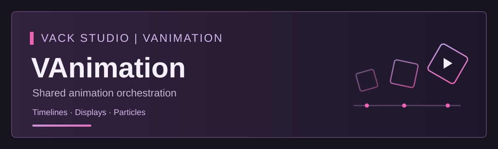

# VAnimation | Vack Studio

Shared animation orchestration for Minecraft plugins, with bounded timelines, cancellation and owned-resource cleanup. Games retain ownership of their rules, movement and rewards.

## Latest prepared preview: 0.3.0-preview.1

- Twelve shipped effects: six vanilla effects plus six Sugarverse effects.
- Consumer-scoped handles, completion outcomes, priority queues and configurable resource limits.
- Item, block and text display animation, transforms and per-viewer visibility.
- Optional Sugarverse demonstration with 50 items and 50 placeable block types, including three sword designs with a configurable self-only Speed/Resistance ability.
- Paginated test kits and exact resource-pack version/hash/APPLIED readiness checks.
- English by default, explicit English / العربية selection and UUID-based language preferences.

Targets **Minecraft Java 26.2 and Java 25**, built against Paper API 26.2.build.134-stable. The prepared preview passed **69 Java tests and 12 resource-pack tests**. Both runtime JARs were rebuilt byte-identically from the delivered source. This version has not completed real-server, graphical-client or mixed-language multiplayer acceptance. No Folia, Leaf, Bedrock or proxy certification is claimed.

The demonstration blocks use vanilla glass collision carriers with custom display models; they are not new client registry blocks. Lantern brightness is visual and does not create real block light. Audio playback integration remains deferred. The latest prepared preview is not a stable release.

## Availability and license

Source and installable artifacts are distributed privately. This repository is an information-only showcase, without binaries or download links.

**License: Proprietary — All rights reserved.** See [LICENSE](LICENSE).

---

## العربية

إضافة مشتركة لتنسيق الأنيميشن لإضافات Minecraft، مع تسلسلات زمنية محدودة وإلغاء وتنظيف للموارد المملوكة. تبقى قواعد اللعب والنقل والمكافآت من مسؤولية اللعبة.

### أحدث نسخة تجريبية مجهزة: 0.3.0-preview.1

- 12 مؤثرًا مرفقًا: ستة مؤثرات فانيلا وستة مؤثرات Sugarverse.
- تشغيل وإلغاء معزولان بحسب الإضافة المستهلكة، وقوائم انتظار بالأولوية وحدود موارد قابلة للتخصيص.
- أنيميشن عرض العناصر والبلوكات والنصوص، مع التحويلات والظهور الخاص لكل مشاهد.
- إضافة تجربة اختيارية تضم 50 آيتم و50 نوع بلوك، منها ثلاثة تصاميم سيوف بقدرة سرعة ومقاومة مؤقتة قابلة للتخصيص.
- دفعات لتجربة العناصر، مع التحقق من إصدار الريسورس باك والهاشات وحالة APPLIED.
- الإنجليزية افتراضيًا، واختيار English / العربية صراحةً، وحفظ اللغة بحسب UUID.

الهدف **Minecraft Java 26.2 وJava 25**، والبناء على Paper API 26.2.build.134-stable. اجتازت النسخة المجهزة **69 اختبار Java و12 اختبار ريسورس باك**، وأُعيد بناء الجارين من السورس المرفق بنتائج مطابقة بايتًا ببايت. اختبار هذا الإصدار على سيرفر وعميل رسومي ولاعبين بلغتين لم يكتمل؛ لا يوجد ادعاء بتوافق Folia أو Leaf أو Bedrock أو Proxy.

تستخدم بلوكات التجربة تصادم زجاج فانيلا وموديلات عرض مخصصة؛ ليست بلوكات جديدة مسجلة عند العميل. سطوع الفانوس مرئي ولا ينتج إضاءة فعلية للبلوكات. تكامل تشغيل الصوت ما زال مؤجلًا. النسخة المجهزة تجريبية وليست إصدارًا مستقرًا.

### التوفر والترخيص

المصدر والملفات التنفيذية تُوزّع بصورة خاصة. هذا المستودع للتعريف فقط، دون ملفات تنفيذية أو روابط تنزيل.

**الترخيص: ملكية خاصة — جميع الحقوق محفوظة.** راجع [LICENSE](LICENSE).

Copyright (c) Vack Studio. All rights reserved.
